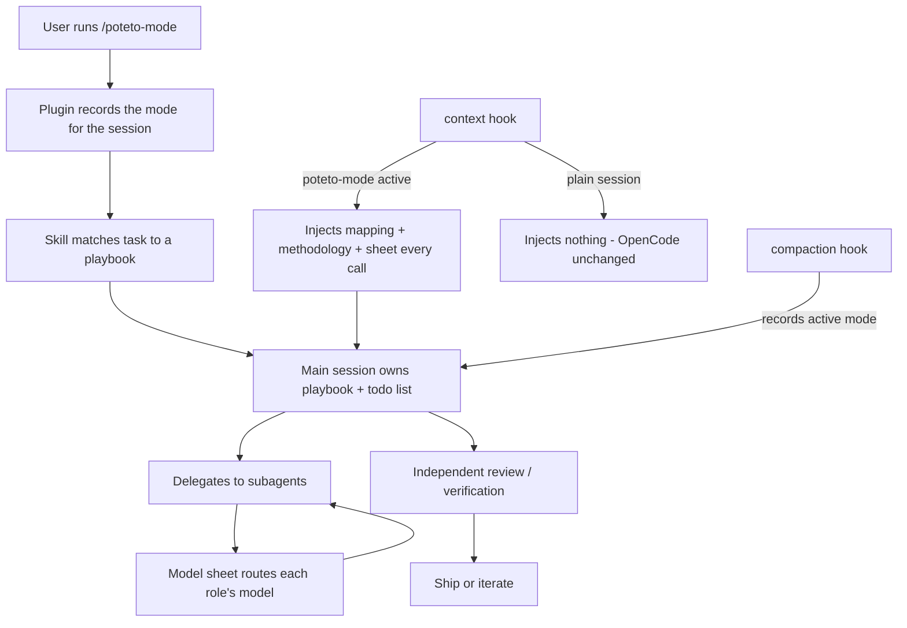

# pstack for OpenCode

> A faithful, independent port of Lauren Tan's [**pstack**](https://github.com/cursor/plugins/tree/main/pstack) to [OpenCode](https://opencode.ai).

---

## Credits

<p>
  <a href="https://github.com/poteto">
    
  </a>
</p>

**pstack is the work of [Lauren Tan](https://github.com/poteto)** ([@poteto](https://x.com/poteto)), a software engineer who has worked across Meta, Netflix, and Cursor, and who helps build and maintain [React Compiler](https://react.dev/learn/react-compiler) on the React core team. pstack encodes the skills she uses every day to ship high-quality code, turning an AI editor into a rigorous engineering team — "throughput without quality is not a goal I aspire to."

- Original repository: [cursor/plugins → pstack](https://github.com/cursor/plugins/tree/main/pstack)
- Original license: [MIT](https://github.com/cursor/plugins/blob/main/pstack/LICENSE)

**pstack-for-opencode is an independent compatibility port.** It is not produced by, endorsed by, or affiliated with Lauren Tan or Cursor. The vendored pstack content is preserved byte-for-byte; this project adds only the OpenCode delivery layer on top of it.

---

## What this is

pstack is a collection of skills, playbooks, principles, and subagents that make an AI agent write less but higher-quality code. The original targets Cursor. This port delivers the same content natively inside OpenCode:

- **60 skills** — one slash command each (`/poteto-mode`, `/how`, `/why`, `/architect`, `/tdd`, `/arena`, `/swarm`, `/interrogate`, …).
- **22 playbooks** — the step-by-step workflows `/poteto-mode` routes to (feature, bug fix, refactoring, perf, shipping, and more).
- **24 principles** — one short skill per engineering principle, applied by instruction.
- **3 subagents** — `pstack:poteto-agent` (the worker), `pstack:readonly` and `pstack:comment-sicko` (read-only reviewers).
- **Automatic model routing** — a model sheet assigns a different model per role.

The original content is vendored unchanged and verified against a pinned manifest. See [docs/parity.md](docs/parity.md) for the exact substitution list and the measured record.

---

## Quick start

```bash
# 1. Clone this repository
git clone https://github.com/shamirbaral5180/pstack-for-opencode.git pstack-for-opencode

# 2. Point OpenCode at it (see Installation below)

# 3. In OpenCode, run the setup command, then start a task
/setup-pstack
/poteto-mode <your task>
```

---

## Installation

### Prerequisites

- [OpenCode](https://opencode.ai) — tested on version 2.4.1.
- One or more models configured in OpenCode (any provider works).

No Node.js is required to *use* the plugin; Node is only needed if you run the repository's own development scripts.

### 1. Install the plugin

OpenCode loads plugins from the `plugins` array in its global config. Add the absolute path to this checkout:

```jsonc
// ~/.config/opencode/opencode.jsonc
{
  "$schema": "https://opencode.ai/config.json",
  "plugins": ["C:/path/to/pstack-for-opencode"]
}
```

On macOS or Linux the path is the normal POSIX path, for example `/home/you/pstack-for-opencode`.

> OpenCode's `opencode plugin add` takes an npm or Git package specifier, not a local path. If this repository is published to a registry or a Git remote you can reach, you can use that instead of the config array; otherwise the config-array method above is the way to install a local checkout.

### 2. Restart OpenCode

Configuration changes apply without a restart, but a fresh start guarantees the plugin loads cleanly. If the commands don't appear, run `/reload` inside OpenCode.

### 3. Verify it loaded

Type `/` and confirm the pstack commands are listed, or run `/setup-pstack` — if it works, the plugin is installed.

---

## Usage

### Configure models with `/setup-pstack`

`/setup-pstack` reads the models actually configured in your OpenCode instance, asks you to pick a reasoning budget, and writes a model sheet to `~/.config/opencode/pstack-models.md`. Each role gets a model:

| Role | What it covers |
| --- | --- |
| `feature, refactoring`, `bug-fix`, `perf-issue`, `hillclimb` | Code work |
| `judgment and prose` | Reviewers and prose |
| `arena runners`, `interrogate reviewers` | Multi-model panels (comma-separated lists) |
| `arena cross-judge pool` | The Arena judge |
| `swarm workers` | Parallel workers and verification |

The sheet is read fresh on every request, so editing it takes effect immediately. To disable routing and sheet injection, add `# session hook: off` to the sheet.

### Do rigorous work with `/poteto-mode`

`/poteto-mode <task>` is the main entry point. It makes pstack the **controlling engineering methodology for that session**: it matches your task to one of the 22 playbooks, opens a todo list of the playbook's steps, delegates implementation to subagents, and routes to the other skills as needed. The methodology stays active for the rest of the session — through follow-up messages and context compaction — and other sessions are left untouched. Examples:

```
/poteto-mode this form submits twice on double-click; find the root cause and fix it.
/poteto-mode add a --dry-run flag to the deploy script, with a test.
```

The chat that receives `/poteto-mode` owns the playbook, the todo list, and every subagent spawn — there is no separate orchestrator.

### Use skills and subagents directly

Any skill has a matching command: `/how`, `/why`, `/architect`, `/tdd`, `/arena`, `/swarm`, `/interrogate`, `/unslop`, and the rest. The three subagents are:

- `pstack:poteto-agent` — the worker for delegates.
- `pstack:readonly` — a read-only reviewer that cannot write, run shell, or spawn agents.
- `pstack:comment-sicko` — a read-only comment reviewer.

### Automatic model selection

When you spawn a subagent **without** naming a model, the plugin assigns it from the sheet: `poteto-agent` gets the code role, and the reviewers get `judgment and prose`. To route a subagent to a *different* provider, pass the model explicitly on the spawn call (`provider/model#variant`), since OpenCode's model hook can only switch within a provider.

---

## How it works



The port adds three layers on top of the unchanged pstack content:

1. **Registration** — every skill, playbook, principle, and agent is translated from Cursor paths and tool names to OpenCode equivalents, then registered as a skill, command, and subagent.
2. **Gated routing** — the main agent uses the original Poteto Mode skill to select the route. It reads and follows the selected playbook or workflow skill; the adapter does not maintain a second list of routes. Plain sessions receive no pstack instructions or fallback todo tool.
3. **Persistence** — activating a skill records the mode in a session instruction entry, so the methodology stays active through follow-ups, context compaction, and plugin reloads.
4. **Model sheet** — `/setup-pstack` writes a per-role model mapping that the agents and the model hook read.

When the active session lacks native `todowrite`, pstack exposes `pstack_todowrite`. Its list is stored in OpenCode's session instruction entries, not in a repository file or the native Desktop todo panel. When the host has native `todowrite`, pstack uses it and drops the fallback.

In Poteto Mode the checklist and a pre-tool checkpoint validate observable prerequisites against the selected playbook, without choosing a route or inferring conditional decisions:

- **Unconditional skill prerequisites.** Steps that say to use, run, or apply a skill — for example Feature step 2's `architect`, Bug fix step 2's `why`, and the `sequence-verifiable-units` reference — must be loaded in full before the checklist advances past them. Conditional clauses (`if`, `when`, `unless`) are never promoted to requirements.
- **Mandatory implementation handoff.** A playbook step that delegates code to a subagent requires an attributable worker change, not just a spawn. On the fallback list, the main agent must first save the step in progress with the project-relative implementation `paths`, name those files in the worker's brief, and load the step's mandatory principle leaf. A successful worker edit or write whose diff matches a declared path satisfies the handoff; a shell-only change does not.
- **Observed, not blocked, shell effects.** A shared snapshot that shows workspace changes during a shell or Code Mode step is reported as an observation — it cannot identify the writer, so investigation, scaffolding, and verification proceed, but a shell-only change never satisfies a delegation step.

The checkpoint is an evidence check, not a security boundary: it cannot attribute arbitrary shell writes to a specific agent, detect work done outside observable tools, or prove that a loaded skill was actually applied.

---

## Comparison: original pstack vs. pstack-for-opencode

| Area | pstack (Cursor) | pstack-for-opencode (this port) |
| --- | --- | --- |
| **Architecture** | Main session orchestrates; no separate orchestrator | Same — the `/poteto-mode` chat owns the run |
| **Skills** | Native Cursor skills | 60 translated skills, one slash command each |
| **Playbooks** | 22, instruction-driven | Same 22, translated |
| **Principles** | 24, loaded through `/poteto-mode` | Same 24, translated |
| **Agents** | `poteto-agent`, `comment-sicko`, Task/Agent subagents | 3 subagents (`poteto-agent`, `readonly`, `comment-sicko`) |
| **Model routing** | Per-role rules read by each skill | Model sheet + agent defaults + a model hook |
| **Verification** | `control-ui` / `control-cli` (in `cursor-team-kit`) | Same skills translated; project verification skills |
| **Arena** | Multi-model panel, worktree isolation | Same, with vendor-level model families |
| **Interrogate** | Adversarial reviewers | Same, fan-out over the reviewers line |
| **Eval** | Blinded experiments | Same playbook, translated |
| **Automation** | Cursor `/loop` | An OpenCode automation (adapter skill) |
| **Platform** | Cursor (macOS/Linux conventions) | OpenCode, cross-platform; some upstream scripts are macOS/Linux-only |

---

## Verified features vs. limitations

**Verified by runtime testing:**

- Skill, command, and subagent registration (60 skills, 60 commands, 3 subagents).
- Cursor-to-OpenCode translation with zero Cursor-only markers remaining.
- `/setup-pstack` writing a valid per-role model sheet.
- Automatic and cross-provider model assignment, read back from child-session metadata.
- Arena fan-out with worktree isolation and vendor-family diversity.
- Interrogate with multiple reviewers, Blinded Eval, and Loop-to-completion.
- Pause → cold restart → session pickup, and instruction recovery after context compaction.
- PR creation → verification → merge (with `gh` installed).
- The read-only boundary (reviewers cannot write or run shell).

**Known limitations (not defects in the port):**

- **CI babysitting is unverified.** The `babysit` playbook depends on a live CI pipeline (GitHub Actions) and the `watch-pr` watcher, which requires [bun](https://bun.sh). Neither a real failing CI run nor the watcher was exercised end to end here, so babysitting is documented rather than claimed.
- `worktree-cleanup` reclaimers (`xcrun simctl`, `df -h`) are macOS/Linux-only.
- The `statechart` skill needs `mise` + TLC + Java on first run.
- Bugbot and Cursor's managed cloud agents have no OpenCode equivalent and are out of scope.
- A cross-provider role change requires an explicit `model` on the spawn or a plugin reload.

---

## Troubleshooting

- **Commands don't appear after editing config** — run `/reload` in OpenCode, or restart it.
- **`/setup-pstack` writes `inherit-parent` everywhere** — your instance has no models configured yet; connect a provider first.
- **A reviewer subagent can't read a directory** — by default reviewers read the workspace plus external directories; verify the target is inside the workspace or the external-directory path is reachable.
- **Windows PowerShell blocks `npm` scripts** — run the Node entry points directly (`node scripts/verify.mjs`, `node --test test/`), or use `npm.cmd`.
- **`gh` is missing** — the PR/shipping playbooks default to `gh`; install the GitHub CLI and run `gh auth login`.

---

## Development

The original pstack content lives in `vendor/pstack/` and is never edited. The port layer is in `src/` and `scripts/`.

```bash
npm run hash      # record vendor hashes into vendor/MANIFEST.json
npm run generate  # rebuild src/data from the vendor snapshot
npm test          # registration, frontmatter, setup, and permission tests
npm run verify    # manifest, inventory, and path checks
npm run audit     # assert no Cursor-only text survives translation
npm run check     # verify + audit + tests
```

On Windows, if `npm.ps1` is blocked by the execution policy, use `npm.cmd` or the Node entry points directly.

There is also a project-local verification skill at `.opencode/skills/verify-pstack-opencode/` that drives the plugin in a real OpenCode server; see its [SKILL.md](.opencode/skills/verify-pstack-opencode/SKILL.md).

---

## License

The original pstack is © Lauren Tan, licensed under the [MIT License](https://github.com/cursor/plugins/blob/main/pstack/LICENSE). This port retains that license and attribution; the OpenCode delivery layer is MIT as well. See [LICENSE](LICENSE).
